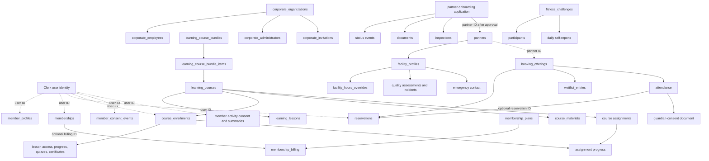

# MaydanGo database entity coverage

| Document field | Value |
|---|---|
| Version | 1.1 |
| Last updated | 20 November 2026 |
| Status | Draft — schema source review |

## Scope

This is a comparison of Section 78 in the product PDF with the Drizzle schema in `lib/db/src/schema/`. It describes the **source schema**, not proof that every migration has been applied to development or production databases.

The schema already supports much of the member, facility, booking, learning, support, and operations scope. Some concepts are intentionally embedded in a domain record or supplied by Clerk rather than represented by a separate table. Finance and payment entities remain gated for the final payment milestone.

## Status key

- **Represented** — a current schema table or external identity system stores the entity.
- **Embedded / shared** — represented as fields or a shared domain record rather than its own table.
- **Partial** — only the stated workflow or limited record type exists.
- **Deferred** — no complete production entity/workflow is represented yet; do not treat it as live.

## Entity map

| PDF entity | Current representation | Status |
| --- | --- | --- |
| Users | Clerk identity IDs referenced by application records; no local password table | Represented externally |
| Customer profiles | `member_profiles` | Represented |
| Optional member profile photos | `member_profile_photos` plus private App Storage objects | Represented; explicit consent and scoped partner delivery |
| Devices and device history | `member_devices`, `member_device_changes`, `member_device_events` | Represented |
| Admin users | Clerk identity plus `operators` | Represented |
| Admin roles and permissions | `operators.role`, `admin_role_permissions` | Represented |
| Partner companies | `partners` | Represented |
| Partner users | Operator records scoped by `partnerId` and partner-role checks | Represented through shared operator model |
| Facilities | `facility_profiles` | Represented |
| Locations | City, district, address, and coordinates stored with facility data | Embedded; no separate location table |
| Categories | Localized activity/category values stored with offering and facility content | Embedded; no central category table |
| Activities and sessions | `booking_offerings` records used by the booking domain | Represented |
| Instructors | `instructor_profiles`, access requests, course assignments, offering assignments | Represented |
| Courses and lessons | `learning_courses`, `learning_lessons`, enrollments, materials, lesson access/progress, quizzes, certificates, assignments, and assignment progress | Represented |
| Saved-course favorites | `member_saved_courses`, unique per member and course | Represented |
| Live classes | Live-class offerings and their schedule/details | Embedded in the offering model |
| Membership plans and rules | `membership_plans` with JSONB access rules | Represented |
| Subscriptions | `memberships`, `access_grants`, and gated `membership_billing` records | Partial; paid lifecycle is gated |
| Facility-access rules and partner-group limits | Membership-plan access-rule snapshots | Embedded in membership rules |
| Bookings | `reservations` | Represented |
| Waiting lists | `waitlist_entries` plus retained legacy history | Represented |
| Check-ins | `attendance`, `attendance_events` | Represented |
| QR codes and challenges | `checkin_challenges`, `manual_checkin_challenges`, `checkin_policies` | Represented |
| GPS records | Coordinates and accuracy are checked transiently during radius validation; the saved attendance record does not retain the member's exact coordinates | Partial by design; no persistent member GPS-history table |
| Payments | `membership_billing`, `payment_webhook_events` | Gated; not a live payment service |
| Refunds | Refund state and provider references in gated billing/correction records | Partial and deferred from launch |
| Invoices | `partner_invoice_submissions`, finance review and correction records | Partial; customer invoicing is deferred |
| Credit notes | No issued credit-note entity; correction records track review metadata and references | Deferred; final accounting treatment requires advice |
| Wallet transactions | No wallet ledger | Deferred |
| Promotions and sponsored placements | Sponsored facility/content campaign and placement-event tables | Represented for sponsored campaigns; no general coupon ledger |
| Referrals | `member_referral_codes`, `member_referral_attributions` | Represented for sign-up attribution only |
| Corporate clients and employees | `corporate_organizations`, `corporate_administrators`, `corporate_employees`, `corporate_invitations` | Represented for employee administration |
| Corporate billing | No active corporate billing ledger | Deferred |
| Events and tickets | Event offerings use the shared offering/reservation model | Partial; no separate ticket ledger and paid ticketing is deferred |
| Partner contracts | `partner_contract_versions`, partner onboarding and compliance records | Represented |
| Partner rates | No normalized partner-rate history table | Deferred with settlement/payment design |
| Settlements | Attendance eligibility and finance review records | Partial; reporting/status only |
| Partner and instructor payouts | No active payout ledger or money-transfer workflow | Deferred |
| Reviews | `facility_reviews`, review reports, responses, and moderation privileges | Represented |
| Support and privacy requests | Support tickets, messages, attachments, events, links, and escalation records; export and deletion requests are typed support cases, not a separate privacy-request table | Represented, with privacy requests handled through support |
| Fraud alerts | Device-risk and attendance signals, restrictions, and urgent support reports | Partial; no complete fraud-case ledger |
| Notifications | Preferences, push devices/deliveries, and member updates | Represented |
| Translations | Localized JSONB content and client language catalogs | Partial; no centralized translation-management table |
| Audit logs | Append-only `operation_audit` and domain-specific event records | Partial; not every domain action is covered by one global ledger |
| Legal-document versions | `legal_policy_versions`, contract-version records, and consent events | Represented |
| Member consent history | `member_consent_events` records terms, privacy, and marketing choices with policy version and timestamp | Represented |
| Guardian-consent evidence | `guardian_consent_documents`, linked to one attendance record with expiry and file-deletion timestamps | Represented; partner verifies requirements onsite |
| Partner onboarding | Applications, status events, documents, and inspection checklists | Represented |
| Facility quality and safety | Assessments, incidents, and emergency contacts | Represented |
| Course collections | `learning_course_bundles` and ordered `learning_course_bundle_items` | Represented for discovery only; does not create enrollment or access |
| Fitness challenges | `fitness_challenges`, participants, and daily self-reports | Represented; self-reports are unique per member, challenge, and date |
| Wearable activity summaries | `member_activity_sync_consent_events` and daily `member_activity_sync_summaries` | Foundation represented; stores only steps/workout counts, not raw health streams |
| Tax settings | No tax-configuration entity | Deferred for qualified Iraqi accounting/legal review |
| Bank-information changes | No dedicated bank-detail change history | Deferred with finance and payout controls |
| Chargebacks | No chargeback case or evidence ledger | Deferred |
| Financial reconciliation | No completed reconciliation ledger or external accounting integration | Deferred |

## Core relationships

The following diagram shows the main relational connections. Solid arrows represent database foreign keys defined in the Drizzle source. Dotted arrows are logical links to Clerk identities or other records that are not enforced as PostgreSQL foreign keys.

### Relationship and integrity rules

- Clerk owns authentication identities. User IDs stored in MaydanGo tables are external identity references; they are not local password records and usually do not have database foreign keys to Clerk.
- A facility belongs to a partner. Bookable offerings are the shared activity, event, and class record; reservations, waitlist entries, and attendance remain separate lifecycle records.
- A member’s membership is not an attendance record. Booking and access eligibility are evaluated by application rules; a reservation never proves that a visit occurred.
- Course bundles are many-to-many through ordered bundle items. A bundle can include a course for discovery without creating an enrollment or overriding course-access requirements.
- Course progress belongs to an enrollment. Lesson-access, lesson-completion, quiz, and assignment-progress records are unique or indexed around that enrollment.
- A guardian-consent document is attached to an attendance record and expires independently. Partner verification happens at the venue; the platform does not store guardian identity details.
- Corporate administrators manage employee enrollment records only. This schema does not grant HR access to member attendance or finance.
- Fitness challenge self-reports are daily records. Wearable synchronization stores daily counts and a consent history rather than raw health or location data.
- Privacy export and account-deletion requests are stored as restricted support cases. A request is not an immediate account deletion.

This relationship map describes the source schema and application-level links; it does not assert that a particular environment has all tables applied.

## Safe implementation approach

Do not create placeholder tables merely to match the PDF list. Add an entity when its owning workflow, access rules, retention, and lifecycle are defined. This avoids redundant tables for concepts already represented by shared records and prevents unsafe financial schemas before the final payment milestone.

Before applying any schema change:

1. Review the Drizzle source schema and existing database structure.
2. Use additive migrations where possible and preserve legacy data.
3. Run the relevant schema and API tests.
4. Apply and verify changes in development first.
5. Do not use `push-force` to bypass a destructive-change prompt.
6. Apply production migrations only through the separately reviewed production process.

The next data-model work should follow the PDF’s remaining implementation scope; wallet, chargebacks, tax configuration, partner rates, and money movement remain deferred with the final finance/payment work.
