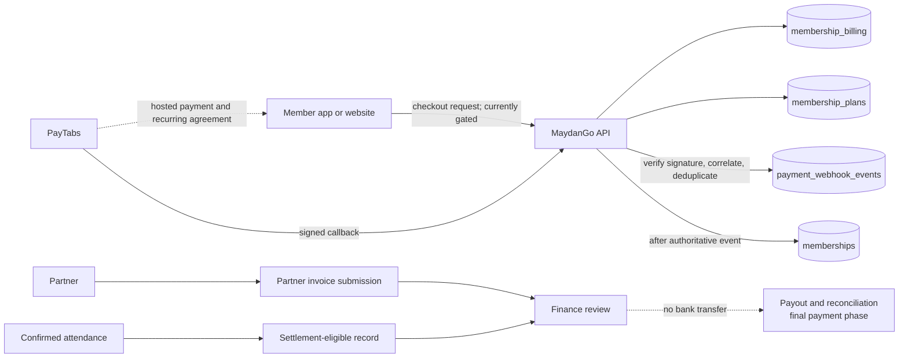

# MaydanGo financial architecture

| Document field | Value |
|---|---|
| Version | 1.0 |
| Last updated | 20 November 2026 |
| Status | Draft — current-state boundaries and deferred target design |
| Related documents | `docs/product-requirements.md`, `docs/technical-architecture.md`, `docs/database-entity-coverage.md` |

## 1. Purpose and boundary

This document records how MaydanGo currently represents membership billing, partner invoices, attendance eligibility, and finance review. It also defines the boundaries that must be confirmed before production financial operations.

**This is a design document only.** It does not enable checkout, connect a provider, issue refunds, initiate payouts, or change finance data. The user’s decision remains in force: live payment work is the final product phase.

## 2. Current financial components

| Component | Current responsibility | Current limitation |
|---|---|---|
| Membership plans | Store plan type, duration, IQD price, and access rules | Plan configuration does not by itself activate paid access |
| Membership billing | Link a member and plan to a billing attempt, period, and provider references | Provider state and live checkout remain gated |
| Membership access | Store the member’s current status, payment status, dates, and access-rule snapshot | Sample or preview access is not proof of a paid entitlement |
| PayTabs callback | Verify the signed raw callback body and pass valid events to the billing handler | Accepted only when all payment configuration and verification gates pass |
| Partner invoices | Store partner-submitted invoice details and private document references | Customer invoices and self-billing are not production capabilities |
| Finance review | Track review items and append-only decision events | Does not constitute a complete accounting ledger or money-transfer system |
| Attendance settlement eligibility | Mark verified visits eligible for finance review when the attendance rules are satisfied | Reporting and review do not initiate partner bank transfers |
| Invoice corrections | Record an idempotent correction against one original billing or partner-invoice record | Final accounting treatment and credit-note workflow need professional review |

## 3. Current architecture and trust boundaries

### Trust rules

- The browser return page is not proof of payment. Membership access must not be activated solely because a customer returns from a hosted checkout.
- The PayTabs webhook handler requires the original raw request body, validates its HMAC signature, correlates the transaction to a local billing record, and processes callback deliveries through a deduplication record.
- Provider state is authoritative for payment and recurring-agreement status. The local billing row stores ownership, the selected plan, amount, dates, and provider references.
- Do not store payment-card numbers, security codes, or other raw card credentials in MaydanGo.
- Booking, check-in, attendance, settlement eligibility, and payout are separate states. A reservation does not count as attendance, and settlement eligibility does not mean a partner has been paid.
- Membership access is checked by the API. A client-side “payment successful” screen cannot grant access.

## 4. Financial records and integrity

### Membership billing

`membership_billing` connects a member and plan to one billing attempt or agreement. Its fields include a local status, payment status, IQD amount, provider checkout and agreement references, period dates, refund status, and legacy provider columns retained during the existing additive provider transition.

`memberships` stores the access lifecycle and rule snapshot separately. Its optional `billingId` reference links a paid membership to the local billing record. Plan access rules are copied into the membership record so later plan edits do not silently rewrite an existing membership’s terms.

### Payment callback events

The callback endpoint verifies a signature over the original body before JSON parsing. A deterministic delivery identifier and `payment_webhook_events` record allow duplicate delivery detection and controlled retry of failed processing. A repeated callback must not create a second membership or duplicate financial change.

### Partner invoices and finance reviews

Partner invoice submissions preserve the partner, invoice number, IQD amount, period, tax reference if supplied, and a private document path. Partner invoice numbers and document paths are unique within their defined scope.

Finance review items include a unique idempotency key. Review decisions are stored separately as append-only finance review events. Invoice corrections are idempotent, retain their reason and creator, and must refer to exactly one original billing or partner-invoice record.

### Attendance and settlements

Attendance is stored separately from reservations. Only the approved attendance workflow can set settlement eligibility. Finance views may summarize eligible visits and submitted partner invoices, but no transfer is implied or initiated by those records.

## 5. Amounts, currency, and retention

- Current plan and finance amounts are represented as whole-number Iraqi dinars (`IQD`). Do not silently assume fractional dinars or convert a value into another currency.
- Currency conversion, foreign-exchange fees, tax rules, and country-specific invoice numbering are not configured in the current product.
- The product default for finance-record retention is ten years. This is a conservative product setting, not a legal determination; an Iraqi legal or accounting adviser must confirm the applicable retention rules before automated deletion is enabled.
- Financial records and correction history must not be removed as ordinary account cleanup. Any retention or deletion process must preserve legally required records and their audit trail.

## 6. Payment gates and deferred scope

The API’s payment configuration requires an explicit enablement flag, HTTPS callback and return URLs, configured provider credentials, and additional test or production verification flags. Until the final phase is approved:

- Keep paid checkout unavailable.
- Do not enable recurring billing or paid membership activation.
- Do not enable production refunds or claim that refunds have been sent.
- Do not build or enable a cash wallet, gift-card balance, gift-course purchase, or paid event/course entitlement.
- Do not create customer invoices or corporate billing claims.
- Do not treat settlement reports or payout-tracking records as executed bank transfers.
- Do not enable partner or instructor payouts, chargeback handling, tax configuration, or financial reconciliation as live workflows.

The provider and finance gates must not be weakened to make a preview flow appear complete.

## 7. Required production design before payment launch

The final payment phase must define and approve:

1. Iraqi payment-provider coverage, supported payment instruments, recurring-payment capability, settlement timing, fees, and operational support.
2. Provider ownership and credentials through the workspace’s secret-management flow; credentials must never be committed or copied into documentation.
3. Transaction lifecycle and reconciliation between provider events, local billing, membership access, refunds, and cancellation.
4. Customer receipts and invoice requirements, invoice numbering, corrections, credit-note treatment, taxes, and legal entity details.
5. Partner and instructor rate agreements, settlement calculation, dispute windows, approval limits, bank-detail change controls, and payout execution.
6. Refund, failed-payment, chargeback, and webhook-replay procedures with idempotency and audit requirements.
7. Finance role assignments, dual approval thresholds, operational ownership, alerts, and incident-response procedures.
8. Backup, restore, reconciliation, and release tests using a verified provider test environment before production enablement.

Legal entity details, business address, registration jurisdiction, Iraqi tax treatment, invoice form, payment-provider approval, and payout agreements remain unconfirmed. No value should be invented for these fields.

## 8. Explicit exclusions

- No change to payment code or runtime configuration.
- No connection or credential request for PayTabs or another provider.
- No payment-flow diagram in this milestone; it remains for the final payment phase.
- No accounting, tax, legal, or provider certification.
- No production database migration.

