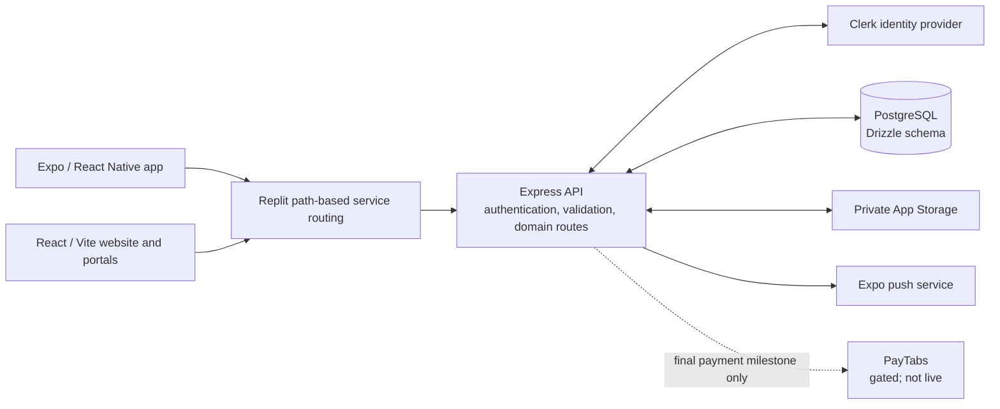

# MaydanGo technical architecture

## Purpose and status

This document describes the architecture that exists in the repository and distinguishes it from capabilities still planned in the product requirements. “Implemented” means there is a working code path; “Partial” means the current scope is narrower than the PDF requirement; “Deferred” means it must not be treated as live or complete.

## System overview

MaydanGo currently uses a **modular backend deployed as one API service**, with a shared PostgreSQL database. Domain modules are grouped by responsibility inside the API; they are not independently deployed microservices.

The API is the shared authority for member eligibility, booking and attendance state, partner and staff permissions, and access to protected content. The web and mobile apps present those capabilities but do not independently grant access.

## Deployable components

| Component | Current role |
| --- | --- |
| Expo mobile app | Member-facing discovery, account, membership, booking, check-in, learning, and support experience. |
| React/Vite website | Public MaydanGo pages and browser-based member and staff experiences. |
| Express API | Shared REST API for public, member, partner, instructor, corporate, operations, support, attendance, and Super Admin functions. |
| PostgreSQL | Shared persistent store accessed through Drizzle ORM and the `lib/db` schema package. |
| OpenAPI toolchain | API contracts in `lib/api-spec`; generated client and Zod packages reduce client/server shape drift. |
| App Storage | File storage for private course media and operational documents; protected files are served through access-checked API routes. |
| Clerk | Authentication identity and session integration. Application role and ownership checks remain in the API. |
| Expo push | Push delivery and delivery recovery for supported notifications. |

## Service coverage against Section 77

| PDF service | Status in the current product |
| --- | --- |
| Authentication | **Implemented:** Clerk middleware and authenticated API routes. |
| User management | **Implemented, scoped:** member profile, device controls, consent, privacy requests, and account restrictions. Identity is provided by Clerk; MaydanGo stores application records in PostgreSQL. |
| Membership-rules engine | **Implemented, not payment-complete:** plan rules and membership snapshots are checked for access, enrollment, and booking. Paid activation remains gated. |
| Facility service | **Implemented:** public facility discovery and authorized operations for facility details and opening hours. |
| Activity service | **Implemented:** offerings, sessions, schedules, approval states, and recurring offerings. |
| Booking engine | **Implemented:** eligibility checks, reservations, cancellations, and durable booking state. |
| Waiting-list engine | **Implemented:** queue, offers, expiry processing, and member/partner visibility. |
| QR validation | **Implemented:** short-lived, single-use check-in codes and staff-assisted verification. |
| GPS validation | **Implemented, pending final radius/device testing:** location is recorded as arrival evidence; partner confirmation remains required where configured. |
| Payment processing | **Deferred:** provider code is gated; live checkout and billing must wait for the final payment milestone and the required provider approvals. |
| Invoice generation | **Partial:** partner invoice submission and finance review exist. Customer invoice generation is not a live billing capability. |
| Wallet service | **Deferred:** do not represent membership credits or visit allowances as a transferable cash wallet. |
| Refund service | **Gated/deferred:** provider operations are subject to the final payment milestone and separate approval controls. |
| Corporate billing | **Deferred:** the current corporate scope is employee enrollment and access administration, not HR access to member activity or finance. |
| Partner settlement | **Partial:** verified attendance and settlement reporting exist; they do not initiate bank transfers. |
| Instructor settlement | **Deferred:** no active instructor payout flow. |
| Course management | **Implemented, scoped:** courses, lessons, access decisions, enrollment, favorites, and member progress. |
| Video-progress tracking | **Implemented, scoped:** lesson playback progress is recorded; protected media access is checked through the API. |
| Live-class integration | **Partial:** live-class schedules and entitlement checks exist; a production streaming-provider integration is not confirmed. |
| Event ticketing | **Partial:** free event reservations can use the booking flow; paid ticket sales are deferred with payment work. |
| Notifications | **Implemented, scoped:** Expo push delivery, recovery, and in-app update paths. |
| Support tickets | **Implemented:** support records, staff replies, attachments, and urgent escalation workflows. |
| Reporting | **Implemented, scoped:** operational and partner reporting; finance figures remain subject to the payment and settlement gates. |
| Fraud monitoring | **Partial:** device, booking, and attendance safeguards provide signals and controls; this is not a complete fraud-detection platform. |
| Translation management | **Partial:** English, Arabic, and Sorani Kurdish are supported in application copy and selected content. A centralized translation CMS for all content is not present. |
| Audit logging | **Partial:** append-only operational audit history covers important administrative changes; it is not yet a universal event log for every subsystem. |
| API integration layer | **Implemented, scoped:** Express REST routes, OpenAPI contracts, generated client helpers, validation, and shared path-based routing. |
| Financial reconciliation | **Deferred:** no completed production reconciliation workflow or external accounting integration. |

## Request and data boundaries

1. The mobile app and website call the API through the project’s path-based proxy; the API remains the source of truth for permissions and business rules.
2. Clerk authenticates the session. API middleware and route-level checks apply roles, partner or organization scope, and ownership rules.
3. Request bodies and key domain transitions are validated before persistence. Important operations record actor and reason in audit history.
4. Drizzle maps domain schemas to PostgreSQL. Schema changes are maintained in `lib/db` and reviewed before they are applied.
5. Public endpoints expose only published content. Private course and operational documents require authorization and are not served as permanent public object URLs.
6. Push notifications are sent through the Expo service; failed deliveries have recovery handling.

## Security and operations

- Authentication and authorization are enforced on the API, not only in client routing.
- API middleware restricts request origins, validates sessions, applies rate limits, and logs requests without retaining query-string contents in the structured request summary.
- Sensitive role paths use role and resource-scope checks. Upload and download paths validate document ownership and purpose.
- Production HTTPS is supplied at the hosting edge when published; the local API process listens behind the platform router.
- Health checks and structured Pino logs are present. Deployment-level backups, disaster recovery, uptime monitoring, and external error monitoring must be configured and verified separately; this document does not claim those controls are active.

## Explicitly deferred or unconfirmed

- Live customer payments, recurring billing, wallet, production refunds, corporate invoices, financial reconciliation, and actual payouts: final payment milestone.
- App Store and Google Play distribution and store URLs: not configured.
- Production streaming, maps, and external accounting providers: no provider is confirmed in the current architecture.
- Centralized translation editing and complete audit coverage: future platform capabilities.
- Production database backup, recovery, monitoring, and security-test evidence: deployment/operations verification remains necessary.

## Source of truth

- API routes and middleware: `artifacts/api-server/src/`.
- Database schema and migrations: `lib/db/src/`.
- API contracts and generators: `lib/api-spec/`.
- Mobile app: `artifacts/maydango/`.
- Website and browser portals: `artifacts/maydango-web/`.
- Section 78 entity-to-schema mapping: `docs/database-entity-coverage.md`.
