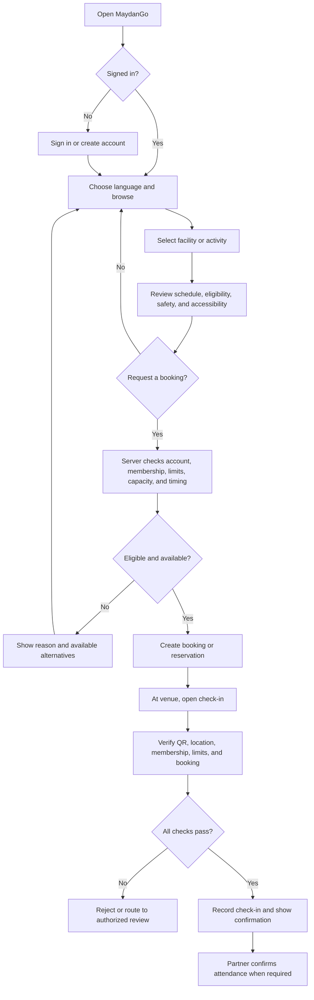
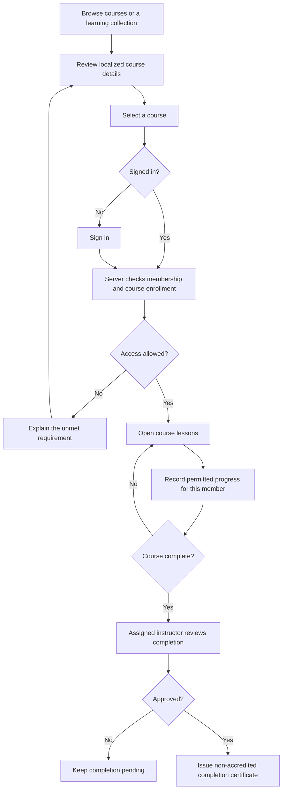
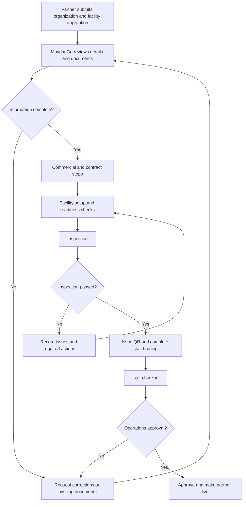
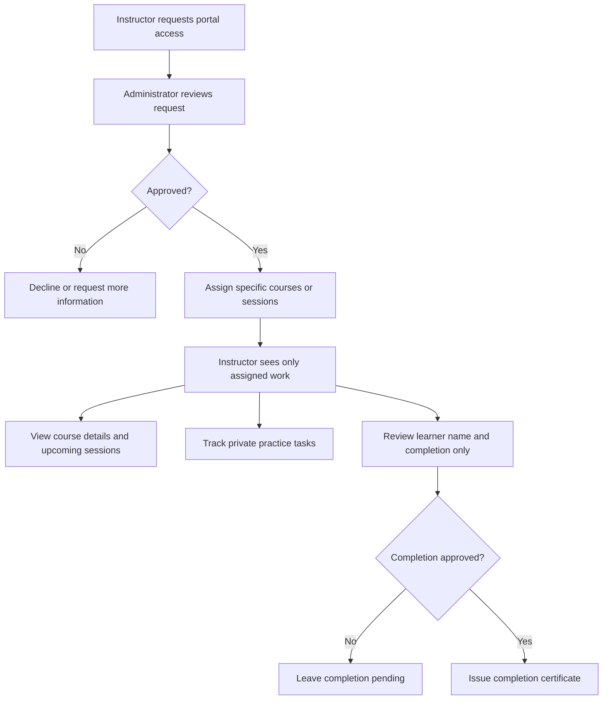
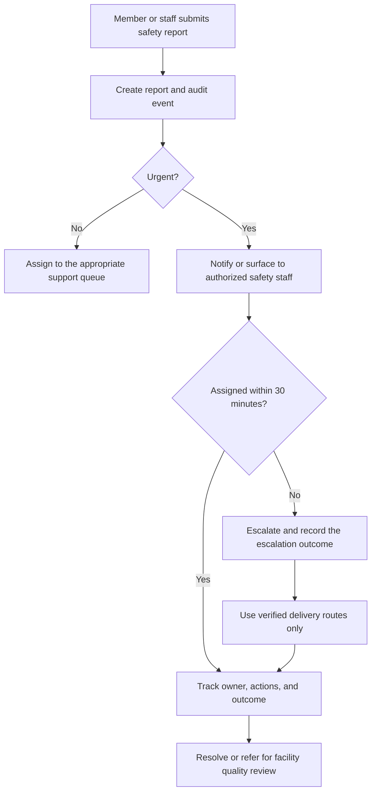
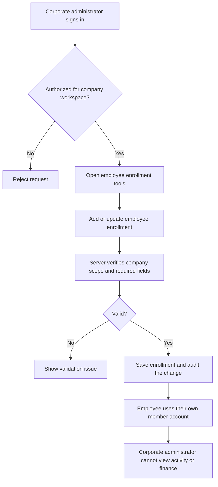
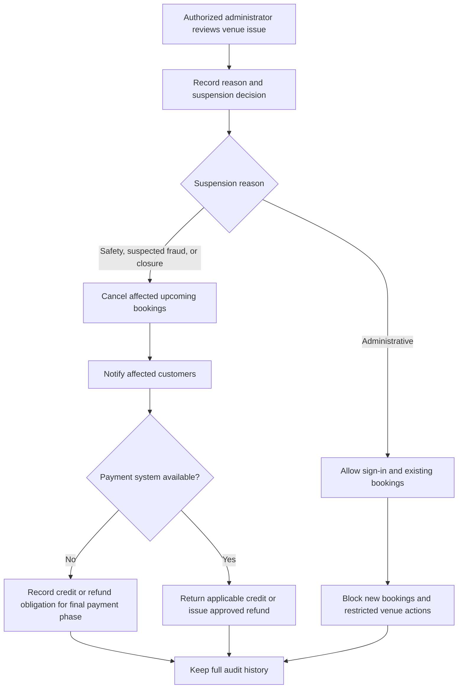
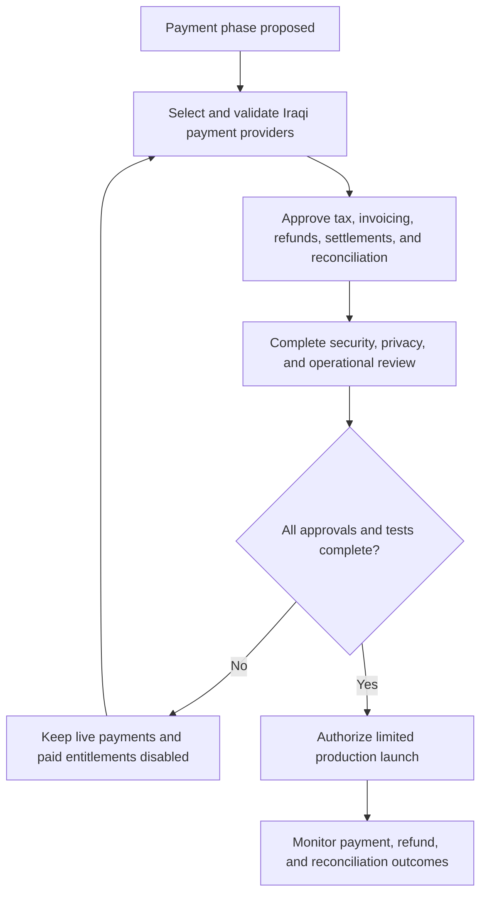

# MaydanGo — User-Flow Diagrams

| Document field | Value |
|---|---|
| Version | 1.0 |
| Last updated | 20 November 2026 |
| Status | Draft for product-owner review |
| Related documents | `docs/product-requirements.md`, `docs/user-stories.md`, `docs/acceptance-criteria.md` |

The diagrams below describe the intended product flows. They are editable Mermaid diagrams and can be rendered by compatible Markdown viewers. Payment and SMS branches are shown as gated future work, not as active integrations.

## 1. Member discovery, booking, and attendance

## 2. Course discovery and protected access

**Collection rule:** A collection groups at least two published courses in an administrator-defined order. It never grants membership, enrollment, lesson access, or payment rights.

## 3. Partner application and facility approval

## 4. Instructor access and assignment

## 5. Urgent safety report and escalation

Email and SMS delivery are not considered active unless the relevant service is connected and verified. The current fallback is in-app.

## 6. Corporate employee enrollment

## 7. Venue suspension behavior

## 8. Final payment launch gate

## Source and document history

These flows derive from the MaydanGo requirements PDF, the product requirements draft, and user-confirmed project decisions. They describe intended behavior and do not claim that any payment, email, SMS, or external streaming integration is connected.

| Version | Date | Author | Change |
|---|---|---|---|
| 1.0 | 20 November 2026 | Replit Agent | Initial user-flow diagrams for the MaydanGo product scope |
